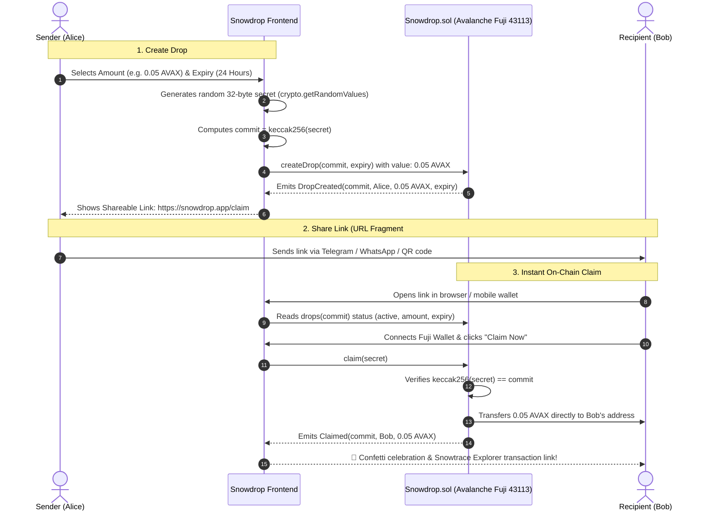

# ❄️ Snowdrop — Send AVAX to Anyone with Just a Link

> **Instant, non-custodial crypto onboarding powered by Avalanche C-Chain.**  
> Send AVAX via a shareable link across Telegram, WhatsApp, or QR code — no wallet address needed beforehand.

[](LICENSE)
[-E84142.svg)](https://testnet.snowtrace.io)
[](https://testnet.snowtrace.io/address/0x5dc8B0b0821ebE7128D911044AACC4F9c4C8B87f)
[](https://soliditylang.org/)
[-success.svg)](test/Snowdrop.test.js)

> 📍 **Live Fuji Smart Contract Address:** [`0x5dc8B0b0821ebE7128D911044AACC4F9c4C8B87f`](https://testnet.snowtrace.io/address/0x5dc8B0b0821ebE7128D911044AACC4F9c4C8B87f)  
> 🔍 **Snowtrace Explorer:** [View on Snowtrace](https://testnet.snowtrace.io/address/0x5dc8B0b0821ebE7128D911044AACC4F9c4C8B87f)

---

## 🌟 The Problem & The Snowdrop Solution

### ❌ The Friction in Web3 Onboarding
Sending cryptocurrency today requires knowing the recipient's exact wallet address, ensuring they are on the right chain, and walking them through complex network configurations before they can even receive a single token.

### ✅ The Snowdrop Solution
1. **Sender Creates Drop**: Sender chooses amount (e.g. `0.05 AVAX`) and expiry (e.g. `24 hours`).
2. **Cryptographic Link Created**: The browser generates a secure 32-byte secret and calculates its hash commitment `commit = keccak256(secret)`. The AVAX is locked into the `Snowdrop.sol` smart contract on Avalanche C-Chain.
3. **Share Anywhere**: The secret is placed only in the URL hash fragment (`https://snowdrop.app/claim#s=<secret>`), which **never reaches any server**.
4. **Instant Non-Custodial Claim**: Recipient opens the link, connects their wallet on Avalanche Fuji, and clicks **Claim Now**. The smart contract verifies the preimage hash on-chain and transfers AVAX directly to their wallet in under 1 second.
5. **Guaranteed Safety (Timelock Refund)**: If the link is never opened or claimed before the expiry time, the original sender can reclaim 100% of the deposited AVAX with 1 click.

---

## 🧭 Live Architecture & Sequence Diagram



---

## 🔒 Security & Cryptographic Guarantees

- **Zero Server Knowledge**: The secret key lives exclusively in the URL hash fragment (`#s=`). According to RFC 3986, hash fragments are strictly client-side and never transmitted in HTTP requests to servers or analytics.
- **Reentrancy Protection**: State updates precede token transfers, secured by OpenZeppelin's `ReentrancyGuard`.
- **Preimage Verification**: The smart contract verifies `keccak256(abi.encodePacked(secret)) == commit` on-chain.
- **Timelocked Refunds**: Unclaimed drops can only be refunded by the original creator after the specified expiry timestamp.
- **Group Drops (First N Claimers)**: Supports distributing funds equally among the first $N$ unique claimers, preventing Sybil multi-claims per address.

---

## 🧪 Smart Contract Test Suite

All 9 security and functional paths are tested with Hardhat and ethers.js v6:

```bash
npx hardhat test
```

```text
  Snowdrop Smart Contract
    Single Drops
      ✔ 1. createDrop: Locks AVAX and stores correct commit and expiry
      ✔ 2. claim: Transfers full AVAX to claimer upon providing valid preimage secret
      ✔ 3. Double-claim rejection: Reverts if already claimed ("invalid/claimed")
      ✔ 4. Expired claim rejection: Reverts if current timestamp > expiry ("expired")
      ✔ 5. Wrong secret rejection: Reverts if keccak256(secret) != commit
      ✔ 6. Refund before expiry rejection: Reverts if sender tries to refund early ("not expired")
      ✔ 7. Refund after expiry: Sends 100% AVAX back to original creator
    Group Drops (First N Claimers)
      ✔ 8. Group drops: First N unique claimers receive perClaim AVAX, (N+1)th reverts
      ✔ 9. Group drop refund: Creator receives remainder of unclaimed AVAX after expiry

  9 passing (6s)
```

---

## 🛠️ Project Structure

```text
snowdrop/
├── contracts/
│   └── Snowdrop.sol          # Production Solidity 0.8.24 contract with ReentrancyGuard
├── test/
│   └── Snowdrop.test.js      # Comprehensive 9-path automated unit test suite
├── scripts/
│   └── deploy.js             # Deployment script for Avalanche Fuji C-Chain
├── app/
│   ├── layout.jsx            # Root layout with responsive navbar, branding & error guards
│   ├── page.jsx              # High-conversion landing page with interactive simulator
│   ├── create/page.jsx       # Drop creation studio (Single Drop & Group Drop)
│   ├── claim/page.jsx        # Instant claim screen with real on-chain claim execution
│   └── my-drops/page.jsx     # Drop management, real-time status & timelocked refunds
├── components/
│   ├── Navbar.jsx            # Sticky navigation with wallet connection & network pill
│   ├── WalletModal.jsx       # Multi-wallet connector (MetaMask, Core, Demo Mode)
│   └── Simulator.jsx         # Live interactive drop creator and claim simulator
├── lib/
│   ├── contract.js           # Smart contract ABI, ethers v6 bindings & crypto helpers
│   ├── walletContext.jsx     # Reactive Web3 context with auto Fuji network switching
│   └── mock.js               # Safe fallback simulation layer
├── hardhat.config.js         # Hardhat configuration for Avalanche Fuji (Chain ID: 43113)
├── LICENSE                   # MIT License (Sumit Raikwar)
└── README.md                 # Project documentation
```

---

## 🚀 Quickstart & Local Setup

### 1. Prerequisites
- Node.js >= 18.0.0
- MetaMask or Core Wallet browser extension

### 2. Clone and Install
```bash
git clone https://github.com/your-username/snowdrop.git
cd snowdrop
npm install
```

### 3. Run Automated Tests
```bash
npx hardhat test
```

### 4. Run Development Server
```bash
npm run dev
```
Open [http://localhost:3000](http://localhost:3000) in your browser.

### 5. Deploy to Avalanche Fuji Testnet (Optional)
When you are ready to deploy to the live Avalanche Fuji C-Chain:
1. Configure your `.env`:
```env
PRIVATE_KEY=your_fuji_burner_private_key
FUJI_RPC_URL=https://api.avax-test.network/ext/bc/C/rpc
```
2. Run the deployment script:
```bash
npx hardhat run scripts/deploy.js --network fuji
```
3. Update `NEXT_PUBLIC_SNOWDROP_ADDRESS` in `.env` with the printed contract address!

---

## 📄 License

This project is open-source under the [MIT License](LICENSE).  
Copyright (c) 2026 **Sumit Raikwar** (`raikwarsumit19@gmail.com`).
