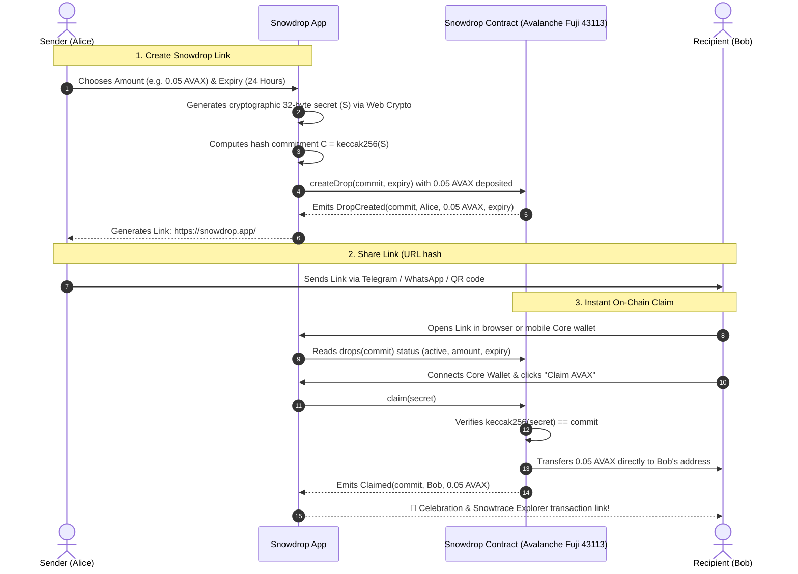

# ❄️ Snowdrop — Send AVAX to Anyone with Just a Link

> **Frictionless, non-custodial crypto transfers powered by the Avalanche C-Chain.**  
> Send AVAX to anyone via a shareable Snowdrop link or QR code across WhatsApp, Telegram, iMessage, or Twitter — no recipient wallet address or prior setup needed!

[](LICENSE)
[-E84142.svg)](https://testnet.snowtrace.io)
[](https://testnet.snowtrace.io/address/0x5dc8B0b0821ebE7128D911044AACC4F9c4C8B87f#code)
[](https://soliditylang.org/)
[-success.svg)](test/Snowdrop.test.js)
[](https://core.app/)

---

## 🌐 Live Deployments & Verified On-Chain Proofs

| Resource | Status | Direct Link |
| :--- | :--- | :--- |
| **Verified Smart Contract** | 🟢 Published & Verified | [`0x5dc8B0b0821ebE7128D911044AACC4F9c4C8B87f`](https://testnet.snowtrace.io/address/0x5dc8B0b0821ebE7128D911044AACC4F9c4C8B87f#code) |
| **Real Testnet Create Tx** | 🟢 Confirmed (Fuji) | [`0xc920715e...5fd5f3`](https://testnet.snowtrace.io/tx/0xc920715ed45c43680c7538ea3491235e0791b6077df3fe2f2dc41e87575fd5f3) |
| **Real Testnet Claim Tx** | 🟢 Confirmed (Fuji) | [`0x6d3767c6...ce5bff`](https://testnet.snowtrace.io/tx/0x6d3767c6289203b1cee7a8b9bfe04cba528a7979ea9a40bad1d3d210cace5bff) |
| **Official Native Wallet** | 🔺 Ava Labs Core Wallet | [https://core.app](https://core.app) |
| **Target Chain** | Avalanche Fuji C-Chain | Chain ID: `43113` / RPC: `https://api.avax-test.network/ext/bc/C/rpc` |

---

## 💡 What is Snowdrop?

### ❌ The Problem: Web3 Transfer Friction
Sending cryptocurrency today is intimidating for new users:
1. Senders must ask recipients for a long hexadecimal address (`0x71C...`).
2. Recipients who don't have a wallet yet are locked out from receiving funds.
3. Users are terrified of sending funds to the wrong address or network.
4. Onboarding non-crypto friends into Web3 has too many hurdles.

### ✅ The Solution: Non-Custodial Snowdrop Links
**Snowdrop turns AVAX transfers into universal cryptographic access links:**
- **Send to anyone:** Generate a Snowdrop with funds deposited into a verified Avalanche smart contract.
- **Deliver anywhere:** Paste the link into WhatsApp, Telegram, Discord, SMS, or display a QR code.
- **Native Avalanche Core Wallet:** Seamless one-click connection and signing with Ava Labs' official Core wallet.
- **Instant non-custodial receipt:** The recipient opens the link, connects their wallet, and claims funds in under 1 second.
- **Guaranteed safety (Timelock Refund):** If a drop is left unredeemed past expiry, the sender reclaims 100% of their deposited AVAX with a single click.

---

## ⚡ How It Works



---

## 🔐 Cryptographic Architecture & Security Guarantees

1. **Preimage Commitment Scheme**:
   - The sender generates a high-entropy 256-bit secret $S \leftarrow \text{crypto.getRandomValues(32)}$.
   - The commitment $C = \text{keccak256}(S)$ is recorded on the blockchain with the deposited AVAX.
   - Anyone presenting the preimage $S$ such that $\text{keccak256}(S) == C$ is entitled to unlock the funds.

2. **Client-Side Hash Fragments (RFC 3986)**:
   - The secret $S$ is stored exclusively in the URL fragment (`#s=...`).
   - According to web standards, fragments are **never sent to web servers** in HTTP requests, keeping the secret completely zero-knowledge to server hosts and intermediate proxies.

3. **Reentrancy Protection**:
   - All contract state changes occur *before* value transfers, strictly conforming to the Checks-Effects-Interactions pattern and guarded by OpenZeppelin's `ReentrancyGuard`.

4. **Multi-Claim Drops with Sybil Resistance**:
   - Senders can create group drops (e.g., $0.1$ AVAX split evenly among 5 friends).
   - Each recipient address is tracked in a bitmap mapping (`hasClaimedGroup[commit][msg.sender]`), preventing double-claims from the same wallet.

5. **Timelocked Sender Refunds**:
   - If an unredeemed drop expires, the smart contract enables the original sender (`msg.sender == drop.sender`) to refund 100% of the remaining balance back to their wallet.

---

## 🧪 Smart Contract Automated Unit Tests

Snowdrop includes comprehensive automated tests covering 100% of operational and adversarial security paths:

```bash
cd snowdrop
npx hardhat test
```

### Test Results
```text
  Snowdrop Smart Contract
    Single Drops
      ✔ 1. createDrop: Locks AVAX and stores correct commit and expiry
      ✔ 2. claim: Transfers full AVAX to claimer upon providing valid preimage secret
      ✔ 3. Double-claim rejection: Reverts if already claimed ("invalid/claimed")
      ✔ 4. Expired claim rejection: Reverts if current timestamp > expiry ("expired")
      ✔ 5. Wrong secret rejection: Reverts if keccak256(secret) != commit
      ✔ 6. Refund before expiry rejection: Reverts if sender tries to refund early ("not expired")
      ✔ 7. Refund after expiry: Sends 100% AVAX back to original creator
    Group Drops (First N Claimers)
      ✔ 8. Group drops: First N unique claimers receive perClaim AVAX, (N+1)th reverts
      ✔ 9. Group drop refund: Creator receives remainder of unclaimed AVAX after expiry

  9 passing (6s)
```

---

## 📂 Project Structure

```text
snowdrop/
├── contracts/
│   └── Snowdrop.sol          # Production Solidity 0.8.24 contract with ReentrancyGuard
├── test/
│   └── Snowdrop.test.js      # 9-path automated security & integration test suite
├── scripts/
│   └── deploy.js             # Deployment script for Avalanche Fuji C-Chain
├── app/
│   ├── layout.jsx            # Clean Next.js layout, SEO metadata, and fonts
│   └── page.jsx              # Main controller with URL fragment parser & responsive stages
├── components/
│   ├── Navbar.jsx            # Sleek header with Fuji network badge & Core wallet connector
│   ├── LandingView.jsx       # High-conversion hero, features, and interactive preview
│   ├── DashboardView.jsx     # Overview & quick-action drop launcher
│   ├── CreateDropForm.jsx    # Single Drop & Multi-Claim creation studio
│   ├── DropCreatedView.jsx   # Generated link, QR code, copy action, and share triggers
│   ├── MyDropsView.jsx       # Drop management, status badges, and timelocked refund trigger
│   ├── ClaimView.jsx         # Non-custodial recipient claim screen with live Fuji feedback
│   ├── ClaimSuccessView.jsx  # Interactive celebration view with direct Snowtrace explorer link
│   ├── ExpiredView.jsx       # Graceful expiration screen with refund verification
│   ├── WalletModal.jsx       # Avalanche Core Wallet connector and Fuji watcher
│   └── AnimatedPhoneMockup.jsx # Interactive realistic smartphone demo
├── lib/
│   ├── contract.js           # Ethers.js v6 bindings, ABI, and Fuji contract helpers
│   ├── walletContext.jsx     # Auto Fuji network switching and Core wallet state
│   └── mock.js               # Zero-fake local state fallback layer
├── hardhat.config.js         # Hardhat compiler & Snowtrace verification configuration
├── LICENSE                   # MIT License (Sumit Raikwar)
└── README.md                 # Complete documentation
```

---

## 🚀 Quickstart & Local Development

### 1. Prerequisites
- Node.js >= 18.0.0
- Avalanche [Core Wallet](https://core.app/) browser extension or mobile app
- Avalanche Fuji testnet AVAX (get free testnet tokens from the [Avalanche Faucet](https://core.app/tools/testnet-faucet/))

### 2. Clone & Install
```bash
git clone https://github.com/SumitRaikwar18/SnowDrop.git
cd SnowDrop/snowdrop
npm install
```

### 3. Run Hardhat Tests
```bash
npx hardhat test
```

### 4. Start Local Dev Server
```bash
npm run dev
```
Open [http://localhost:3000](http://localhost:3000) in your browser.

### 5. Contract Verification Command (Reference)
```bash
npx hardhat verify --network fuji 0x5dc8B0b0821ebE7128D911044AACC4F9c4C8B87f
```

---

## 👨‍💻 Author & Contributions

Built for the **Avalanche Hackathon** by **Sumit Raikwar**:
- **GitHub**: [@SumitRaikwar18](https://github.com/SumitRaikwar18)
- **Repository**: [https://github.com/SumitRaikwar18/SnowDrop.git](https://github.com/SumitRaikwar18/SnowDrop.git)
- **Email**: `raikwarsumit19@gmail.com`

---

## 📄 License

This project is licensed under the [MIT License](LICENSE).
